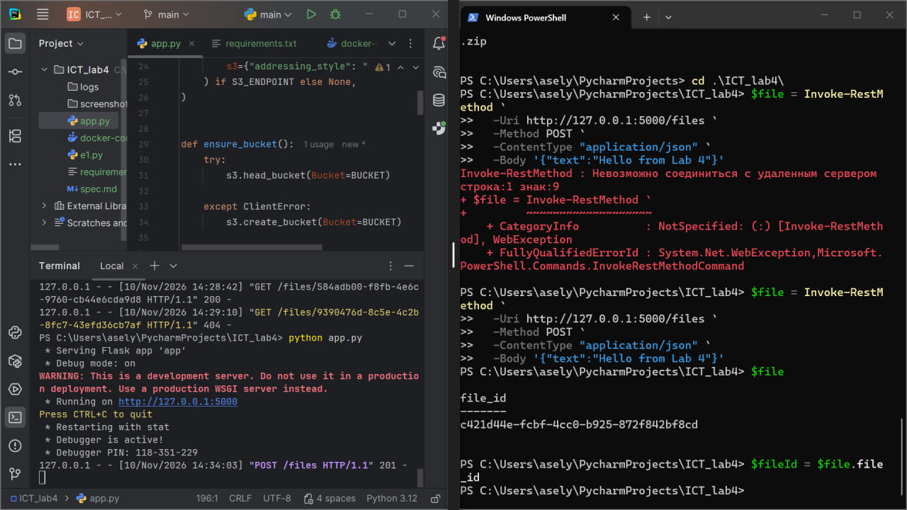
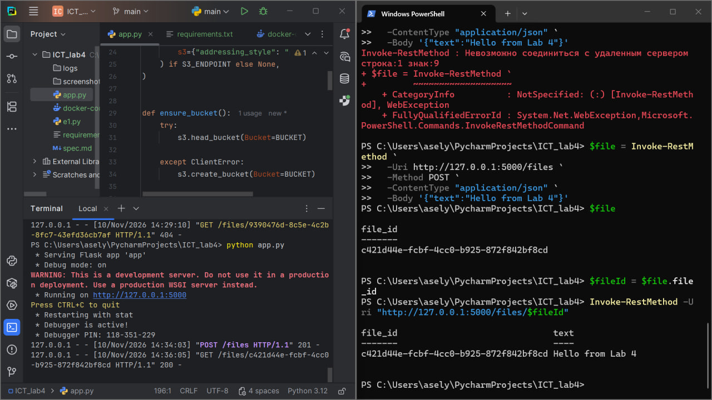
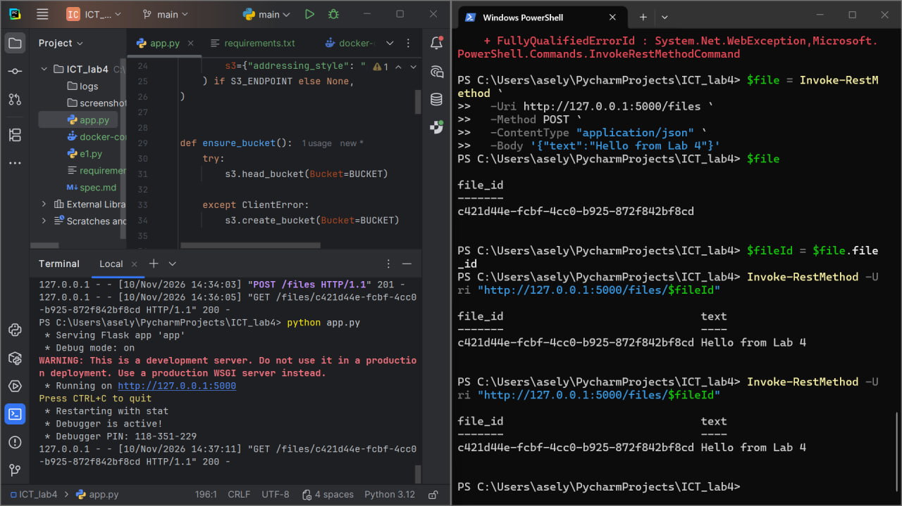
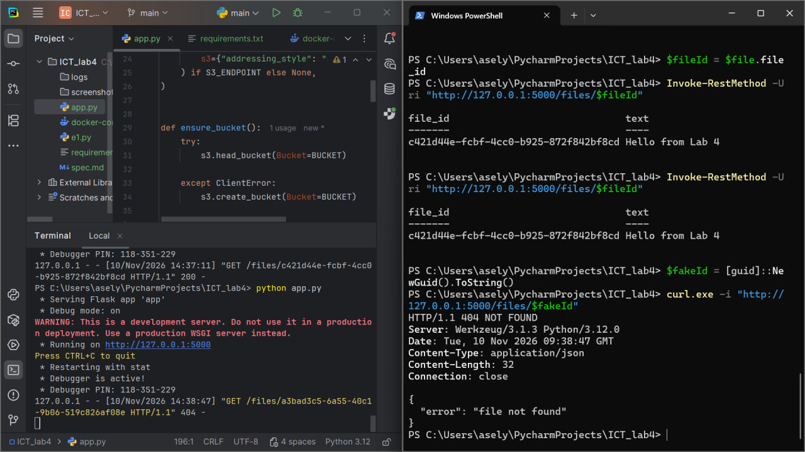
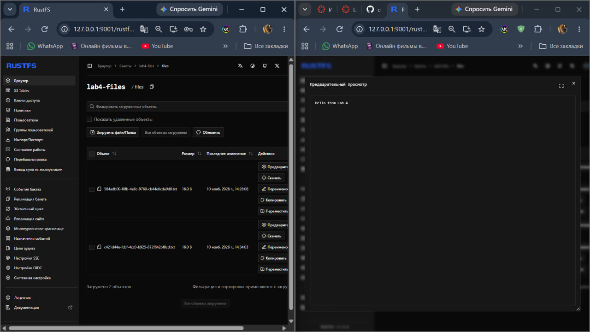
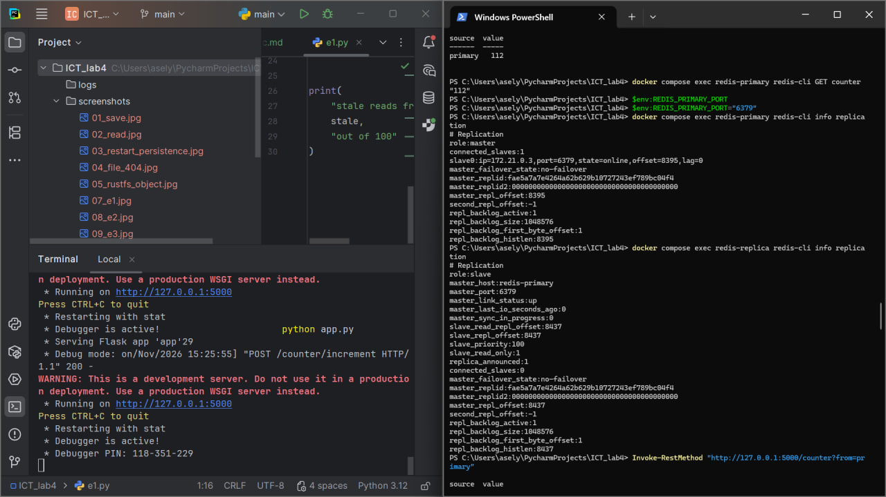
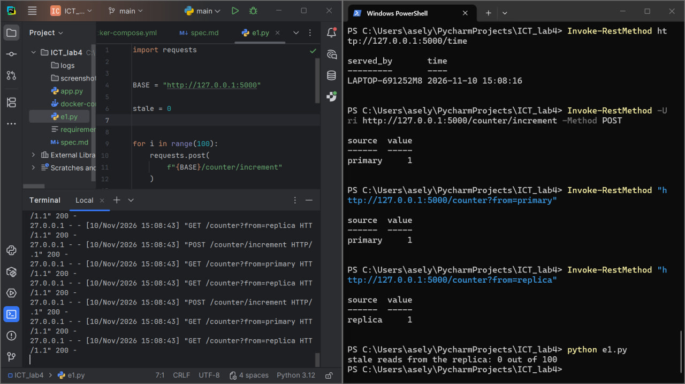
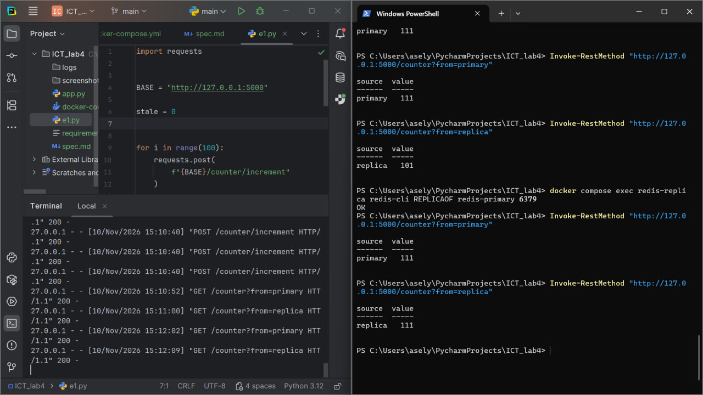
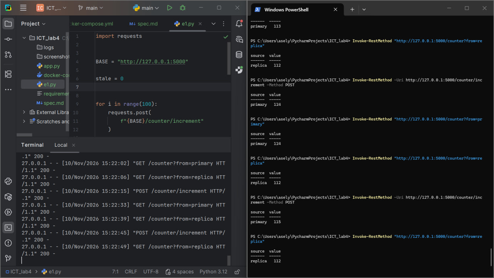
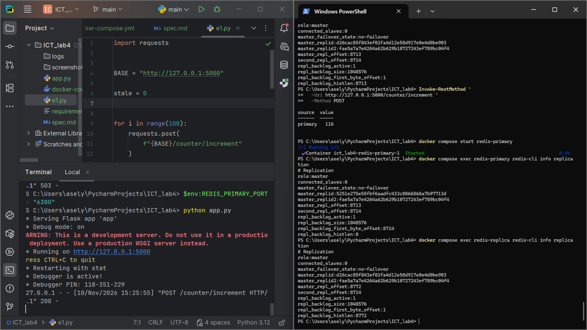

# ICT Lab 4 — Object Storage and Redis Replication

## Project Description

This project is a continuation of Lab 3.

The main goals of this lab were:

- store files outside the application using RustFS;
- check that files remain available after restarting the service;
- use Redis primary and replica;
- observe stale reads and eventual consistency;
- perform manual failover when the primary fails.

The Flask application runs locally, while RustFS and Redis run in Docker containers.

---

## Technologies

- Python
- Flask
- Docker Compose
- RustFS
- Redis
- Boto3
- Requests

---

## Main API Endpoints

### File Storage

- `POST /files` — saves a text file in RustFS.
- `GET /files/<file_id>` — reads a saved file.

### Redis Counter

- `POST /counter/increment` — increments the counter on the primary.
- `GET /counter?from=primary` — reads the counter from the primary.
- `GET /counter?from=replica` — reads the counter from the replica.

---

# Part A — Object Storage

Files are stored in RustFS instead of the local application directory.

## Save File

The API saves the text in object storage and returns a unique file ID.



---

## Read File

The saved file can be read using the same file ID.



---

## Persistence After Restart

The Flask service was stopped and started again.

The previously saved file was still available because the file is stored outside the Flask process.



---

## 404 Error

A request for a file that does not exist returns HTTP `404 Not Found`.



---

## RustFS Storage

The saved object can also be seen directly in the RustFS web console.



---

# Part B — Redis Replication

Redis was started with one primary node and one replica node.

The primary accepts writes and the replica copies data from the primary.



---

## Experiment E1 — Normal Replication

100 writes were performed.

After every write, the counter was read from both the primary and the replica.

On a local computer, Redis replication is very fast, so the number of stale reads can be zero.



---

## Experiment E2 — Replica Lag

The connection between the primary and the replica was manually broken.

After 10 new writes, the primary contained the latest value while the replica still returned an old value.

After replication was restored, the replica synchronized with the primary again.

This demonstrates **replication lag** and **eventual consistency**.



---

## Experiment E3 — Read Your Own Write

The replica was disconnected again.

New writes changed the value on the primary, but the replica continued to return the previous value.

This demonstrates that reading from a replica is not always suitable when the user must immediately see the latest write.



---

## Experiment E4 — Manual Failover

The Redis primary was stopped.

Reading from the replica was still possible, but writing through the API returned HTTP `503`.

The replica was manually promoted to a new primary.

The Flask application was restarted using the new primary port, and writes started working again.

When the old primary was started again, both Redis nodes had the `master` role.

This situation is dangerous because both nodes can accept different writes and their data can become inconsistent.



---

# Reflection Questions

## 1. Why must files not be stored on a container's disk, and how is object storage better?

Containers are temporary.

If a container is removed or recreated, files stored inside the container can be lost.

Object storage keeps the data outside the application container.

In this lab, RustFS stores the files in external storage and uses a Docker volume.

Because of this, the Flask service or the RustFS container can be restarted or recreated without losing the saved files.

Object storage also gives the application a standard API for saving and reading files.

---

## 2. What are replication lag and eventual consistency? What did you see in experiments E1 and E2?

**Replication lag** is the delay between a write on the primary and the moment when the same value becomes available on the replica.

In Experiment E1, the primary and replica were working normally.

Because both Redis nodes were running locally, replication was very fast and there could be zero stale reads.

In Experiment E2, the replica was intentionally disconnected from the primary.

New writes continued on the primary, but the replica returned an older value.

This was a stale read.

After replication was restored, the replica received the new data and eventually had the same value as the primary.

This demonstrates **eventual consistency**.

---

## 3. When is reading from a replica acceptable and when is it not?

Reading from a replica is acceptable when slightly old data is not a serious problem.

For example, it can be acceptable for:

- statistics;
- analytics;
- reports;
- public counters.

Reading from a replica is not appropriate when the user must immediately see the latest data.

For example, after changing a password, account balance, order status, or another important value, reading from a replica could return an old result.

Experiment E3 demonstrated this problem.

The primary showed the latest value after every write, while the disconnected replica continued to show the old value.

---

## 4. What had to be done manually when the primary failed, what happened when the old primary came back, and what changes with automatic failover?

When the primary failed, writes through the API stopped working.

The replica still allowed reads, but it could not automatically become the new primary.

The failover had to be performed manually.

The replica was promoted using:

```text
REPLICAOF NO ONE
```

After that, the Flask application had to be restarted with the port of the new primary.

When the old primary came back, both Redis nodes had the `master` role.

This is dangerous because both masters can accept different writes and create conflicting data.

The old primary should be changed into a replica of the new primary.

With automatic failover, the system automatically detects that the primary has failed and selects a new primary without requiring these manual steps.

---

# Conclusion

In this lab, data was moved outside the Flask application.

RustFS was used for persistent object storage, and Redis primary and replica were used to study replicated state.

The experiments demonstrated:

- persistent object storage;
- primary and replica replication;
- replication lag;
- stale reads;
- eventual consistency;
- manual failover;
- the problem of having two masters after a failure.